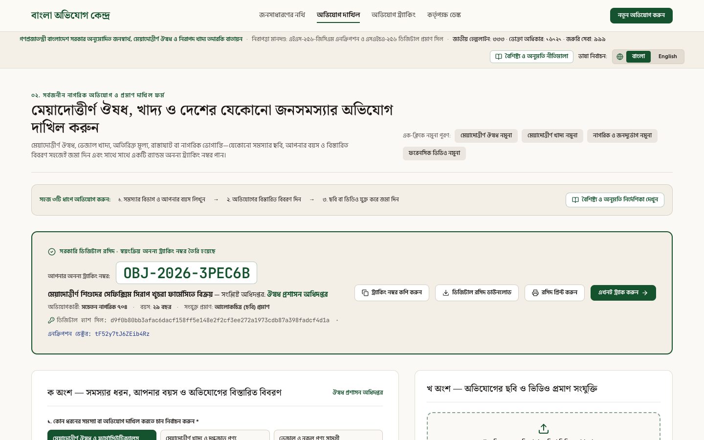
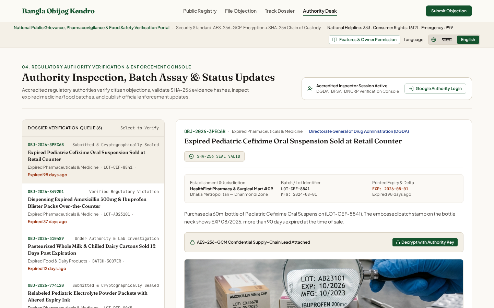
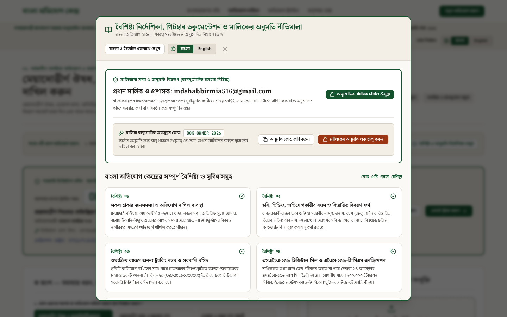
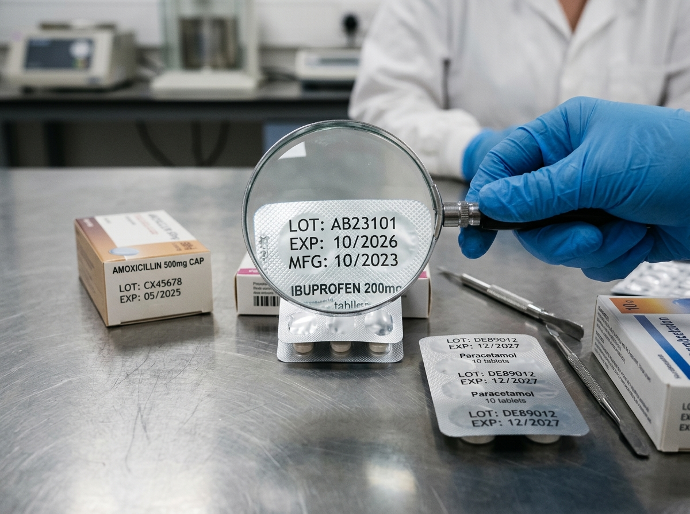
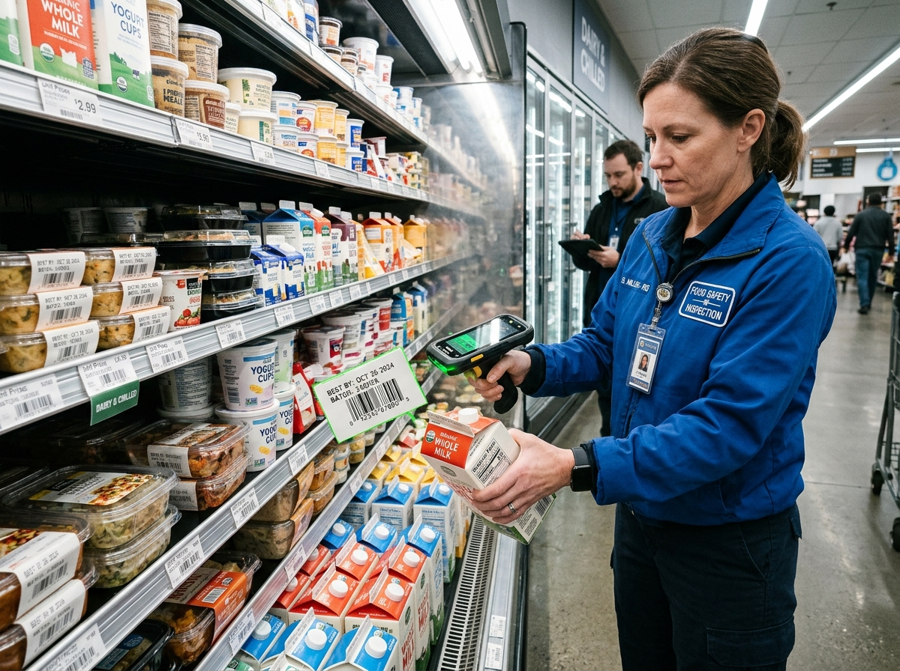

# বাংলা অভিযোগ কেন্দ্র (Bangla Obijog Kendro) — পরীক্ষামূলক প্রোটোটাইপ (Prototype)
### জাতীয় জনঅভিযোগ, মেয়াদোত্তীর্ণ ঔষধ, নিরাপদ খাদ্য ও নিয়ন্ত্রক যাচাই বাতায়ন (প্রোটোটাইপ সংস্করণ)


---

## 📌 গুরুত্বপূর্ণ ঘোষণা: এটি একটি পরীক্ষামূলক প্রোটোটাইপ (আসল সরকারি ওয়েবসাইট নয়)

> **⚠️ বিশেষ দ্রষ্টব্য (Prototype Disclaimer in Bangla):**
> - **এটি কোনো আসল বা দাপ্তরিক সরকারি ওয়েবসাইট নয়।** এই **বাংলা অভিযোগ কেন্দ্র (Bangla Obijog Kendro)** প্রজেক্টটি শুধুমাত্র শিক্ষাগত, গবেষণা এবং সফটওয়্যার ইঞ্জিনিয়ারিং ও সাইবার নিরাপত্তা প্রদর্শনের উদ্দেশ্যে তৈরি একটি **পরীক্ষামূলক প্রোটোটাইপ (Prototype / Concept Demonstration)**।
> - গণপ্রজাতন্ত্রী বাংলাদেশ সরকার বা কোনো সরকারি অধিদপ্তরের (যেমন: ঔষধ প্রশাসন অধিদপ্তর, নিরাপদ খাদ্য কর্তৃপক্ষ, বিএসটিআই বা জাতীয় ভোক্তা অধিকার সংরক্ষণ অধিদপ্তর) সাথে এই প্রোটোটাইপের কোনো দাপ্তরিক বা প্রাতিষ্ঠানিক সম্পর্ক নেই।
> - এই প্রোটোটাইপে প্রদর্শিত অভিযোগ, প্রতিষ্ঠানের নাম, ব্যাচ নম্বর, পরিদর্শক ব্যাজ এবং ট্র্যাকিং নম্বরগুলো সম্পূর্ণরূপে **পরীক্ষামূলক নমুনা ডেটা (Sample / Demo Data)** হিসেবে ব্যবহৃত হয়েছে, যাতে ভবিষ্যতে কীভাবে ক্রিপ্টোগ্রাফিক হ্যাশ সিল ও ব্রাউজার এনক্রিপশন ব্যবহার করে একটি আধুনিক নাগরিক অভিযোগ বাতায়ন তৈরি করা যায় তা প্রদর্শন করা যায়।

---

## 🔒 মালিকানা ও অনুমতি সতর্কবার্তা (Ownership & Permission Notice)

> **সর্বস্বত্ব সংরক্ষিত — ২০২৬**
> - **প্রধান নির্মাতা, মালিক ও নিয়ন্ত্রক:** `mdshabbirmia516@gmail.com`
> - **অনুমতি নীতিমালা:** মালিকের (`mdshabbirmia516@gmail.com`) সুস্পষ্ট লিখিত পূর্বানুমতি ব্যতীত এই প্রোটোটাইপ ওয়েবসাইট, সোর্স কোড, ডাটাবেস স্কিমা বা ক্রিপ্টোগ্রাফিক আর্কিটেকচার কোনো ব্যক্তি বা প্রতিষ্ঠানের দ্বারা অননুমোদিত ব্যবহার, কপি, পুনর্বণ্টন বা ডিপ্লয় করা সম্পূর্ণরূপে নিষিদ্ধ।

---

## ১. প্রোটোটাইপ প্রকল্পের সংক্ষিপ্ত পরিচিতি (Project Overview in Bangla)

**বাংলা অভিযোগ কেন্দ্র** হলো একটি আধুনিক ওয়েব প্রোটোটাইপ, যেখানে নাগরিকরা দেশের যেকোনো জনসমস্যা—যেমন মেয়াদোত্তীর্ণ ঔষধ, মেয়াদোত্তীর্ণ বা ভেজাল খাদ্য, নকল পণ্য, অতিরিক্ত মূল্য আদায়, পৌর ও নাগরিক অবকাঠামোগত ত্রুটি এবং যেকোনো জনদুর্ভোগের বিরুদ্ধে **ছবি (Image), ভিডিও (Video), অভিযোগকারীর বয়স (Age) এবং বিস্তারিত বিবরণসহ** পরীক্ষামূলকভাবে অভিযোগ দাখিল ও ট্র্যাক করতে পারেন।

### এই প্রোটোটাইপের প্রধান বৈশিষ্ট্যসমূহ:

১. **সকল প্রকার সমস্যার জন্য ব্যবহারকারী-বান্ধব অভিযোগ ফর্ম:**
   - মেয়াদোত্তীর্ণ ঔষধ ও ফার্মাসিউটিক্যালস
   - মেয়াদোত্তীর্ণ ও ভেজাল খাদ্য পণ্য
   - ভেজাল ও নকল পণ্য সামগ্রী
   - অতিরিক্ত মূল্য আদায় ও কৃত্রিম সংকট
   - রাস্তাঘাট, পানি, বিদ্যুৎ ও নাগরিক অবকাঠামোগত সমস্যা
   - জনস্বাস্থ্য, হাসপাতাল, পরিবহন ও যেকোনো জনদুর্ভোগ

২. **ছবি, ভিডিও, বয়স ও বিস্তারিত বিবরণ দাখিলের সুবিধা:**
   - ফর্মে অভিযোগকারীর নাম বা ছদ্মনাম (গোপনীয়তা সুরক্ষিত), **অভিযোগকারীর বয়স (বছর)**, অভিযুক্ত প্রতিষ্ঠান বা স্থানের নাম, জেলা/থানা, ব্যাচ বা রেফারেন্স নম্বর এবং ঘটনার পূর্ণাঙ্গ বিবরণ লেখার সহজ ব্যবস্থা রয়েছে।
   - মোবাইল ক্যামেরা বা গ্যালারি থেকে সরাসরি **ছবি (JPG, PNG, WEBP)** ও **ভিডিও (MP4, WEBM)** প্রমাণ আপলোড এবং লাইভ প্রিভিউ দেখার সুবিধা রয়েছে।

৩. **স্বয়ংক্রিয় র‍্যান্ডম অনন্য ট্র্যাকিং নম্বর ও ডিজিটাল রসিদ:**
   - প্রতিটি অভিযোগ জমা দেওয়ার সাথে সাথে ব্রাউজারের ক্রিপ্টোগ্রাফিক র‍্যান্ডম জেনারেটরের (`crypto.getRandomValues`) মাধ্যমে একটি অনন্য ট্র্যাকিং নম্বর (`OBJ-2026-XXXXXX`) তৈরি হয়।
   - দাখিলের পরপরই একটি প্রিন্টযোগ্য ডিজিটাল রসিদ এবং ডাউনলোডযোগ্য JSON সনদ প্রদান করা হয়।

৪. **এসএইচএ-২৫৬ (SHA-256) ডিজিটাল সিল ও এইএস-২৫৬-জিসিএম (AES-256-GCM) এনক্রিপশন:**
   - প্রতিটি অভিযোগের মূল তথ্য ব্রাউজারেই ৬৪-ক্যারেক্টার **SHA-256** ক্রিপ্টোগ্রাফিক হ্যাশ দ্বারা সিল করা হয়, ফলে পরবর্তীতে কোনো তথ্য পরিবর্তন করা হলে তা গাণিতিকভাবে ধরা পড়ে।
   - তথ্যদাতার গোপনীয় সাক্ষ্য বা সরবরাহকারীর তথ্য ব্রাউজারেই **PBKDF2 (১০০,০০০ ইটারেশন)** ও **AES-256-GCM** এনক্রিপশন দ্বারা সুরক্ষিত থাকে।

৫. **বিশুদ্ধ একক ভাষা মোড (বাংলা অথবা ইংরেজি) ও স্বয়ংক্রিয় ফন্ট পরিবর্তন:**
   - **বাংলা** নির্বাচন করলে সম্পূর্ণ ওয়েবসাইট শতভাগ বিশুদ্ধ বাংলায় (এবং বাংলা সংখ্যায় `০-৯`) **Noto Serif Bengali** ও **Hind Siliguri** ফন্টে প্রদর্শিত হয়।
   - **English** নির্বাচন করলে সম্পূর্ণ ওয়েবসাইট শতভাগ বিশুদ্ধ ইংরেজিতে **Fraunces** ও **Plus Jakarta Sans** ফন্টে প্রদর্শিত হয়।
   - যেকোনো পৃষ্ঠা থেকে এক ক্লিকে বা `Alt + L` শর্টকাট চেপে ভাষা পরিবর্তন করা যায়।

৬. **কর্তৃপক্ষ যাচাই ডেস্ক (প্রোটোটাইপ সিমুলেশন) ও মালিকের অনুমতি লক:**
   - এই প্রোটোটাইপে একটি কর্তৃপক্ষ যাচাই ডেস্ক রয়েছে, যেখানে কীভাবে একজন পরিদর্শক বা প্রশাসক (`mdshabbirmia516@gmail.com`) অভিযোগের সত্যতা যাচাই, হ্যাশ সিল পরীক্ষা এবং অবস্থা (`তদন্তাধীন`, `প্রমাণিত আইন লঙ্ঘন`, `নিষ্পত্তিকৃত`) আপডেট করতে পারেন তা প্রদর্শন করা হয়েছে।
   - মালিকের অনুমতি ছাড়া কেউ যাতে অননুমোদিতভাবে ফর্ম ব্যবহার বা পরিবর্তন করতে না পারে সেজন্য **Owner Permission Lock (`BOK-OWNER-2026`)** এবং ফায়ারস্টোর জিরো-ট্রাস্ট রুলস সংযুক্ত রয়েছে।

---

## ২. প্রোটোটাইপ ওয়েবসাইটের স্ক্রিনশট ও চিত্রের বিস্তারিত ব্যাখ্যা

নিচে এই প্রোটোটাইপ ওয়েবসাইটের প্রতিটি প্রধান পাতা (Screen) এবং সংযুক্ত নমুনা প্রমাণচিত্রগুলোর বিস্তারিত ব্যাখ্যা বাংলায় দেওয়া হলো:

### চিত্র ১: প্রধান পাতা ও প্রকাশ্য নিবন্ধন তালিকা (বিশুদ্ধ বাংলা মোড)


- **ব্যাখ্যা:**
  - এই স্ক্রিনশটে **বাংলা অভিযোগ কেন্দ্র** প্রোটোটাইপের প্রধান পাতা দেখা যাচ্ছে।
  - উপরের স্টিকি বারে এক-ক্লিকে ভাষা পরিবর্তনের বাটন (`বাংলা | English`) এবং `বৈশিষ্ট্য ও অনুমতি নীতিমালা` বাটন রয়েছে।
  - বাম পাশে তাৎক্ষণিক ট্র্যাকিং নম্বর (`OBJ-2026-849201`) দিয়ে নমুনা অভিযোগ খোঁজার বক্স এবং নিচে মোট সিলযুক্ত অভিযোগ, মেয়াদোত্তীর্ণ ঔষধ ও খাদ্য মামলা, যাচাইকৃত মামলা এবং এনক্রিপ্টেড গোপনীয় সাক্ষ্য নথির পরিসংখ্যান কার্ড রয়েছে।

---

### চিত্র ২: সর্বজনীন অভিযোগ দাখিল ফর্ম (ছবি, বয়স ও বিবরণ) এবং স্বয়ংক্রিয় ট্র্যাকিং রসিদ



- **ব্যাখ্যা:**
  - এই স্ক্রিনশটে দেখা যাচ্ছে একজন ব্যবহারকারী পরীক্ষামূলকভাবে **অভিযোগকারীর নাম (`সচেতন নাগরিক ৭০৪`), বয়স (`২৯ বছর`), বিস্তারিত বিবরণ এবং প্রমাণের ছবি** সংযুক্ত করে একটি অভিযোগ জমা দিয়েছেন।
  - অভিযোগ জমা দেওয়ার সাথে সাথে উপরে সবুজ বর্ডারের **ডিজিটাল রসিদ (Receipt Card)** তৈরি হয়েছে, যেখানে একটি স্বয়ংক্রিয় র‍্যান্ডম অনন্য ট্র্যাকিং নম্বর (`OBJ-2026-3PEC6B`), ৬৪-ক্যারেক্টার `SHA-256` ডিজিটাল হ্যাশ সিল এবং `AES-256-GCM` এনক্রিপশন ভেক্টর প্রদর্শিত হচ্ছে।
  - রসিদ থেকে এক ক্লিকে ট্র্যাকিং নম্বর কপি, JSON সনদ ডাউনলোড, প্রিন্ট এবং লাইভ ট্র্যাকিংয়ে যাওয়ার বাটন রয়েছে।

---

### চিত্র ৩: কর্তৃপক্ষ যাচাই ও অবস্থা আপডেট কনসোল (বিশুদ্ধ ইংরেজি মোড)



- **ব্যাখ্যা:**
  - যখন ব্যবহারকারী `English` ভাষা নির্বাচন করেন, তখন সম্পূর্ণ প্রোটোটাইপ ওয়েবসাইট শতভাগ বিশুদ্ধ ইংরেজিতে পরিবর্তিত হয়।
  - এই পাতায় বাম পাশের তালিকা থেকে যেকোনো অভিযোগ নির্বাচন করে তার `SHA-256 SEAL VALID` স্ট্যাটাস যাচাই, এক ক্লিকে `AES-256-GCM` গোপনীয় তথ্য ডিক্রিপ্ট এবং তদন্তের ফলাফল আপডেট করার প্রক্রিয়া প্রদর্শন করা হয়েছে।

---

### চিত্র ৪: বৈশিষ্ট্য নির্দেশিকা ও মালিকের অনুমতি লক মোডাল (`mdshabbirmia516@gmail.com`)



- **ব্যাখ্যা:**
  - এই পপ-আপ মোডালে প্রোটোটাইপ পোর্টালের প্রধান মালিক ও প্রশাসক হিসেবে **`mdshabbirmia516@gmail.com`**-এর নাম ও মালিকানা সনদ প্রদর্শিত হচ্ছে।
  - এখান থেকে মালিক এক ক্লিকে **কঠোর অনুমতি লক (`BOK-OWNER-2026`)** চালু বা বন্ধ করতে পারেন, যাতে মালিকের অনুমতি ছাড়া কেউ ফর্ম ব্যবহার করতে না পারে।

---

### চিত্র ৫, ৬ ও ৭: প্রোটোটাইপে ব্যবহৃত নমুনা প্রমাণ ও আর্কাইভ আলোকচিত্রসমূহ

এই প্রোটোটাইপে মেয়াদোত্তীর্ণ ঔষধ, খাদ্য নিরাপত্তা এবং আর্কাইভ প্রদর্শনের জন্য নিচের ৩টি নমুনা আলোকচিত্র (`src/assets/images/`) ব্যবহৃত হয়েছে:

| আলোকচিত্র (Image Preview) | ফাইল ও প্রোটোটাইপে ব্যবহারের ক্ষেত্র |
| :---: | :--- |
|  | **১. আর্কাইভ ব্যানার চিত্র (`civic_oversight_archive_hero_1794048838779.jpg`)**<br/>প্রধান পাতার হিরো সেকশনে নথি ও ল্যাবরেটরি যাচাই কার্যক্রমের প্রতীকী আলোকচিত্র হিসেবে ব্যবহৃত। |
|  | **২. মেয়াদোত্তীর্ণ ঔষধের ব্লিস্টার প্যাকের নমুনা ছবি (`evidence_medicine_blister_batch_1794048839663.jpg`)**<br/>ঔষধের প্যাকেটে মুদ্রিত ব্যাচ নম্বর (`LOT: AB23101`) ও মেয়াদের তারিখ (`EXP: 10/2026`) আতশ কাঁচ দিয়ে পরীক্ষার নমুনা প্রমাণচিত্র। |
|  | **৩. মেয়াদোত্তীর্ণ খাদ্য ও বারকোড পরিদর্শনের নমুনা ছবি (`evidence_food_safety_label_1794048839964.jpg`)**<br/>কোল্ড-চেইন শেলফে রাখা দুগ্ধজাত ও প্রক্রিয়াজাত খাদ্যের মেয়াদের বারকোড স্ক্যান করার নমুনা প্রমাণচিত্র। |

---

## ৩. প্রোটোটাইপের সিস্টেম ও সিকিউরিটি আর্কিটেকচার ব্যাখ্যা

### আর্কিটেকচার ডায়াগ্রাম (Architectural Flow Diagram)

```text
+---------------------------------------------------------------------------------------------------+
|               বাংলা অভিযোগ কেন্দ্র (Bangla Obijog Kendro) — পরীক্ষামূলক প্রোটোটাইপ (SPA)            |
|                     React 19 + TypeScript + Tailwind CSS v4 + Dynamic Font Engine                 |
|                  [ বিশুদ্ধ বাংলা মোড (bn) ]  <--- (Alt + L) --->  [ Pure English Mode (en) ]      |
+---------------------------------------------------------------------------------------------------+
          |                                              |                                  |
          v                                              v                                  v
+--------------------+                       +-----------------------+          +-------------------+
| ১. অভিযোগ ফর্ম     |                       | ২. ক্রিপ্টো ইঞ্জিন    |          | ৩. মালিকানা লক ও   |
| (FileObjection)    |---------------------->| (cryptoAndValidation) |          | যাচাই কনসোল       |
| - ৬টি সমস্যা বিভাগ |   যাচাইকৃত ইনপুট      | - CSPRNG ট্র্যাকিং ID  |          | - অনুমতি কোড:      |
| - অভিযোগকারীর বয়স |                       |   (OBJ-2026-XXXXXX)   |          |   BOK-OWNER-2026  |
| - ছবি ও ভিডিও      |                       | - SHA-256 হ্যাশ সিল   |          | - হ্যাশ যাচাইকারী  |
| - মেয়াদ বিশ্লেষক  |                       | - PBKDF2 (100k iter)  |          | - AES-GCM ডিক্রিপ্ট|
+--------------------+                       |   + AES-256-GCM       |          +-------------------+
                                             +-----------------------+                    |
                                                         |                                |
                                                         v                                v
+---------------------------------------------------------------------------------------------------+
|                     ডুয়াল স্টোরেজ ও জিরো-ট্রাস্ট ফায়ারস্টোর ডাটাবেস স্তর                        |
|  - লোকাল লেজার (localStorage): তাৎক্ষণিক প্রোটোটাইপ ডেমো ও রিলোড পারসিস্টেন্সের জন্য               |
|  - Firebase Cloud Firestore (ai-studio-cda27417-b41a-41ab-b6e3-4badfb97e395)                      |
|  - ৮-স্তম্ভের জিরো-ট্রাস্ট firestore.rules:                                                       |
|      * ডিফল্ট-ডিনাই (Default-Deny) নিরাপত্তা বেষ্টনী                                              |
|      * ২৬টি ফিল্ডের কঠোর স্কিমা যাচাই (hasAll + hasOnly)                                          |
|      * অপরিবর্তনীয় authorId, trackingId, createdAt, sha256Hash                                   |
|      * প্রধান মালিকের বিশেষ নিয়ন্ত্রণ: mdshabbirmia516@gmail.com (email_verified == true)        |
+---------------------------------------------------------------------------------------------------+
```

### আর্কিটেকচারের প্রতিটি স্তরের বাংলা ব্যাখ্যা:

১. **প্রেজেন্টেশন ও ডায়নামিক ভাষা স্তর (`src/i18n/translations.ts` ও `src/index.css`):**
   - সম্পূর্ণ প্রোটোটাইপটি একটি একক-ভাষা বিশুদ্ধতা (Single-Language Purity) ইঞ্জিনের ওপর নির্মিত।
   - যখন ব্যবহারকারী `বাংলা` নির্বাচন করেন, তখন `document.documentElement.lang = 'bn'` এবং `.lang-bn` ক্লাস সক্রিয় হয়, যা স্বয়ংক্রিয়ভাবে **Noto Serif Bengali** ও **Hind Siliguri** ফন্ট লোড করে এবং সমস্ত সংখ্যা বাংলা অঙ্কে (`০-৯`) রূপান্তর করে।
   - যখন `English` নির্বাচন করা হয়, তখন `.lang-en` ক্লাস সক্রিয় হয়ে **Fraunces** ও **Plus Jakarta Sans** ফন্ট প্রয়োগ করে।

২. **ক্লায়েন্ট-সাইড ক্রিপ্টোগ্রাফিক ও ভ্যালিডেশন ইঞ্জিন (`src/utils/cryptoAndValidation.ts`):**
   - **র‍্যান্ডম অনন্য ট্র্যাকিং নম্বর (`generateTrackingId`):** ব্রাউজারের `crypto.getRandomValues` ব্যবহার করে প্রতিটি অভিযোগের জন্য `OBJ-2026-XXXXXX` ফরম্যাটে একটি অনন্য ট্র্যাকিং নম্বর তৈরি করে।
   - **অপরিবর্তনীয় ডিজিটাল সিল (`computeDossierSha256` ও `verifyDossierIntegrity`):** অভিযোগের মূল তথ্যগুলো একত্রিত করে ব্রাউজারের `crypto.subtle.digest('SHA-256', ...)` এর মাধ্যমে ৬৪-ক্যারেক্টারের হেক্সাডেসিমেল হ্যাশ তৈরি করে। পরে কেউ একটি অক্ষরও পরিবর্তন করলে হ্যাশ যাচাইয়ে তা ধরা পড়ে।
   - **জিরো-নলেজ এনক্রিপশন (`encryptConfidentialPayload` ও `decryptConfidentialPayload`):** তথ্যদাতার গোপনীয় নোট ব্রাউজারেই `PBKDF2` (১০০,০০০ ইটারেশন, SHA-256 সল্ট) এবং `AES-256-GCM` (৯৬-বিট র‍্যান্ডম IV) দ্বারা এনক্রিপ্ট হয়ে সাইফারটেক্সট হিসেবে সংরক্ষিত হয়।
   - **মেয়াদ বিশ্লেষক (`calculateExpiryAnalysis`):** পণ্যের মেয়াদের তারিখ পরীক্ষা করে কত দিন আগে মেয়াদ উত্তীর্ণ হয়েছে তা হিসাব করে এবং স্বয়ংক্রিয়ভাবে ঝুঁকির মাত্রা (`Critical`, `High`, `Elevated`, `Routine`) নির্ধারণ করে।

৩. **জিরো-ট্রাস্ট ফায়ারস্টোর ডাটাবেস ও মালিকের অনুমতি স্তর (`firestore.rules` ও `firebase-blueprint.json`):**
   - প্রতিটি ফায়ারস্টোর ডকুমেন্ট `isValidObjection()` ফাংশনের মাধ্যমে ২৬টি নির্ধারিত ফিল্ড (`hasAll` ও `hasOnly`) এবং সর্বোচ্চ দৈর্ঘ্য (`maxLength`) অনুযায়ী যাচাই করা হয়।
   - শুধুমাত্র প্রধান মালিক **`mdshabbirmia516@gmail.com`** (যাচাইকৃত ইমেইলসহ) অথবা `/admins/{adminId}` কালেকশনে অনুমোদিত ব্যবহারকারী অভিযোগের অবস্থা (`status`, `authorityNote`, `enforcementAction`) পরিবর্তন করতে পারেন।

---

## ৪. ফাইল ও ফোল্ডার কাঠামো (Directory Structure)

```text
/
├── README.md                                  # বাংলায় প্রোটোটাইপ পরিচিতি, আর্কিটেকচার ও ছবির ব্যাখ্যা
├── firebase-blueprint.json                    # ফায়ারস্টোর ডাটাবেস স্কিমা ব্লুপ্রিন্ট (IR)
├── firestore.rules                            # ৮-স্তম্ভের জিরো-ট্রাস্ট ফায়ারস্টোর সিকিউরিটি রুলস
├── firestore.rules.test.ts                    # ক্রিপ্টোগ্রাফি ও ১২টি অ্যাডভার্সারিয়াল সিকিউরিটি ইউনিট টেস্ট
├── public/
│   └── screenshots/                           # গিটহাব README-তে ব্যবহৃত প্রোটোটাইপের ৪টি স্ক্রিনশট
│       ├── 01-public-registry-bangla.png
│       ├── 02-file-objection-form-and-receipt.png
│       ├── 03-authority-desk-english.png
│       └── 04-feature-and-owner-permission-guide.png
└── src/
    ├── App.tsx                                # প্রধান অ্যাপ্লিকেশন, ভাষা সুইচার ও ফায়ারস্টোর সিঙ্ক
    ├── index.css                              # বাংলা ও ইংরেজি ফন্ট কনফিগারেশন ও টেইলউইন্ড স্টাইল
    ├── assets/images/                         # মেয়াদোত্তীর্ণ ঔষধ, খাদ্য ও আর্কাইভের নমুনা আলোকচিত্র
    ├── components/
    │   ├── Header.tsx                         # ৩-জোন স্টিকি ন্যাভিগেশন হেডার
    │   ├── HeroArchiveSection.tsx             # প্রধান ব্যানার, কুইক ট্র্যাকার ও পরিসংখ্যান কার্ড
    │   ├── PublicRegistrySection.tsx          # সার্চ ও ফিল্টারসহ সর্বজনীন অভিযোগ রেজিস্ট্রি
    │   ├── FileObjectionSection.tsx           # ছবি, বয়স ও বিবরণসহ অভিযোগ দাখিল ফর্ম ও ডিজিটাল রসিদ
    │   ├── TrackingPortalSection.tsx          # ট্র্যাকিং নম্বর দিয়ে লাইভ অগ্রগতি ও অডিট ট্রেইল যাচাই
    │   ├── AuthorityDeskSection.tsx           # কর্তৃপক্ষ যাচাই ও অবস্থা আপডেট কনসোল (প্রোটোটাইপ)
    │   ├── DossierDetailModal.tsx             # পূর্ণাঙ্গ ডসিয়ার ও হ্যাশ যাচাই মোডাল
    │   ├── EvidenceMediaViewer.tsx            # ছবি ও ফরেনসিক ইউভি ভিডিও প্রমাণ ভিউয়ার
    │   └── FeatureAndPermissionModal.tsx      # বৈশিষ্ট্য নির্দেশিকা ও মালিকের অনুমতি লক মোডাল
    ├── data/
    │   └── seedObjections.ts                  # প্রারম্ভিক পরীক্ষামূলক নমুনা অভিযোগসমূহ
    ├── i18n/
    │   └── translations.ts                    # বিশুদ্ধ বাংলা ও ইংরেজি ভাষা ডিকশনারি ও অনুবাদ ইঞ্জিন
    ├── lib/
    │   └── firebase.ts                        # ফায়ারবেস এসডিকে ও এরর হ্যান্ডলার ইনিশিয়ালাইজেশন
    ├── types/
    │   └── objection.ts                       # টাইপস্ক্রিপ্ট ইন্টারফেস ও ডাটা মডেল
    └── utils/
        └── cryptoAndValidation.ts             # SHA-256, AES-256-GCM, ট্র্যাকিং আইডি ও ভ্যালিডেশন ইঞ্জিন
```

---

## ৫. গিটহাব থেকে ইনস্টল ও চালানোর নিয়ম (Installation & Commands)

### ১. ডিপেন্ডেন্সি ইনস্টল করুন:
```bash
npm install
```

### ২. লোকাল ডেভেলপমেন্ট সার্ভার চালু করুন (পোর্ট ৩০০০):
```bash
npm run dev
```

### ৩. ক্রিপ্টোগ্রাফিক ও সিকিউরিটি রুলস ইউনিট টেস্ট চালান:
```bash
npx --yes tsx --test firestore.rules.test.ts
```

### ৪. প্রোডাকশন বিল্ড তৈরি করুন:
```bash
npm run build
```

---

## ৬. লাইসেন্স ও যোগাযোগ (License & Owner Contact)

- **প্রকল্পের নাম:** বাংলা অভিযোগ কেন্দ্র (Bangla Obijog Kendro — পরীক্ষামূলক প্রোটোটাইপ)
- **প্রকল্পের ধরন:** শিক্ষাগত ও গবেষণামূলক সফটওয়্যার প্রোটোটাইপ (আসল সরকারি ওয়েবসাইট নয়)
- **প্রধান মালিক ও নির্মাতা:** `mdshabbirmia516@gmail.com`
- **অনুমতি নীতিমালা:** সর্বস্বত্ব সংরক্ষিত (All Rights Reserved). `mdshabbirmia516@gmail.com`-এর লিখিত অনুমতি ব্যতীত কেউ এই প্রোটোটাইপ প্রজেক্ট কপি, পরিবর্তন বা অননুমোদিত কাজে ব্যবহার করতে পারবে না।
